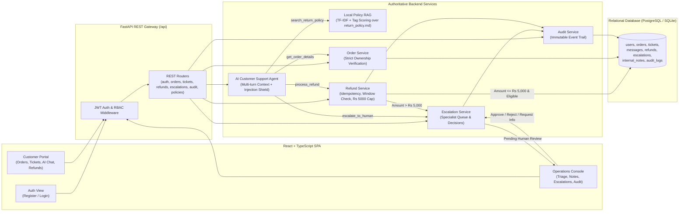

# System Architecture — Kestrel Support & Resolution Suite

## High-Level Architecture & Human-Review Flow

## AI Agent Tool & Guardrail Pipeline

1. **Prompt-Injection Firewall**: Incoming customer chat turns are screened against policy-override and privilege-escalation patterns before tool invocation. Blocked attempts are logged to `audit_logs` without executing any refund or order tools.
2. **Multi-Turn Context Resolution**: Extracts `ORD-*` references from the active message, linked ticket `order_id`, or earlier conversation turns. If missing on an order-dependent intent, the agent sets ticket status to `awaiting_customer` and asks for clarification without invoking tools prematurely.
3. **Deterministic Tool Binding**:
   - `get_order_details(order_id)` verifies account ownership and prevents cross-customer data leakage.
   - `search_return_policy(category)` retrieves category rules from `backend/app/policies/return_policy.md` using TF-IDF + category tag scoring.
   - `process_refund(order_id, amount, reason)` delegates strictly to `RefundService`, which validates delivery status, calendar return window, idempotency key, duplicate order refunds, and the `₹5,000` automated limit.
   - `escalate_to_human(ticket_id, summary, priority)` creates an `Escalation` record and transitions the ticket to `escalated` for human specialist review.
4. **LLM Separation of Concerns**: Even when an external OpenAI-compatible LLM is enabled (`LLM_PROVIDER=openai_compatible`), the LLM only formats verified server outcomes—it never executes SQL or authorizes refunds.
