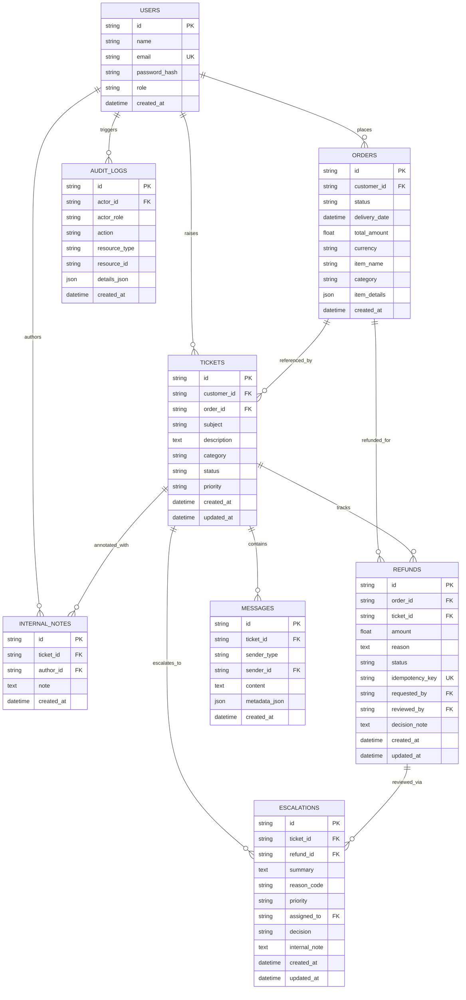

# Database Schema & Entity-Relationship Diagram

## Entity-Relationship Diagram

## Indexes & Constraints

- **Unique Constraints**: `users.email`, `refunds.idempotency_key` (`uq_refunds_idempotency_key`).
- **Composite Indexes**:
  - `ix_orders_customer_status` on `(customer_id, status)`
  - `ix_tickets_status_priority` on `(status, priority)`
  - `ix_tickets_customer_created` on `(customer_id, created_at)`
  - `ix_messages_ticket_created` on `(ticket_id, created_at)`
  - `ix_refunds_order_status` on `(order_id, status)`
  - `ix_escalations_decision_priority` on `(decision, priority)`
  - `ix_audit_logs_resource` on `(resource_type, resource_id)`
- **Migrations**: Managed via Alembic (`backend/alembic/versions/001_initial_schema.py`) and verified against both SQLite and PostgreSQL dialects.
